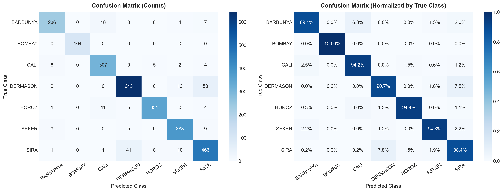
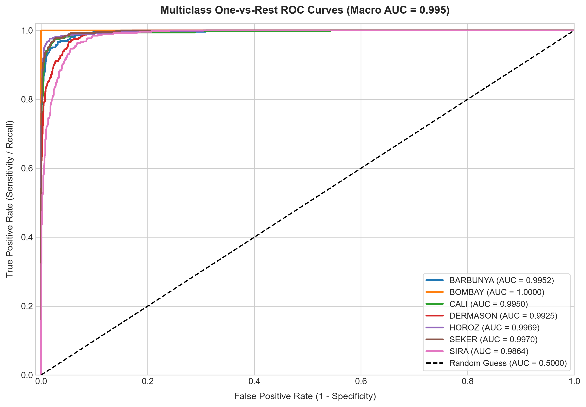

# Dry Bean Variety Classification Using Multiclass Logistic Regression

[](https://www.python.org/)
[](https://scikit-learn.org/)
[](https://flask.palletsprojects.com/)
[](https://github.com/astral-sh/uv)
[](https://opensource.org/licenses/MIT)

An applied machine learning system that classifies **seven commercial varieties of dry beans (*Phaseolus vulgaris L.*)** using computer vision-derived morphological and shape features. The project implements an end-to-end scikit-learn pipeline featuring feature standardization and regularized **Multinomial Logistic Regression**, paired with a full-stack Flask web application for real-time inference.

---

## Executive Summary & Key Results

| Metric | Score | Note |
| :--- | :--- | :--- |
| **Test Accuracy** | **91.92%** | Evaluated on held-out 20% stratified test set (2,709 samples) |
| **5-Fold Stratified CV Accuracy** | **92.42% ± 0.35%** | Consistent performance across all training partitions |
| **Training Accuracy** | **92.60%** | Tight generalization gap (under 0.70%), zero overfitting |
| **Macro-Average ROC-AUC** | **0.995** | High class separation across all decision thresholds |
| **Weighted-Average ROC-AUC** | **0.993** | Robust against cultivar sample imbalance |
| **Best Performing Class** | **Bombay (100% Precision / 100% Recall)** | Perfectly separated due to distinct large grain size |

---

## Problem Context & Agricultural Domain

Quality inspection, purity verification, and variety sorting of dry bean seeds are vital for certified seed production, market valuation, and automated food packaging. Because commercial bean cultivars command different market prices and exhibit distinct culinary characteristics (cooking duration, canning properties), automated classification using digital imaging replaces subjective, labor-intensive manual sorting with high-throughput computer vision.

### The 7 Target Varieties:
1. **SEKER:** Round, spherical cultivar
2. **BARBUNYA:** Oval bean with distinctive speckled markings
3. **BOMBAY:** Exceptionally large white bean
4. **CALI:** Large kidney bean variety
5. **DERMASON:** Small, flat white bean (most common commercial group)
6. **HOROZ:** Long, cylindrical white bean
7. **SIRA:** Small, flat, medium-light cultivar

---

## Dataset & Morphological Features

The dataset was acquired from the [UCI Machine Learning Repository](https://archive.ics.uci.edu/dataset/602/dry+bean+dataset) (Koklu & Ozkan, 2020). It consists of **13,611 grain images** captured with a high-resolution camera, from which **16 geometric and shape features** were extracted:

| Feature Name | Description |
| :--- | :--- |
| **Area** | Number of pixels within the bean boundary |
| **Perimeter** | Circumference length of the bean margin |
| **MajorAxisLength** | Longest distance through the grain body |
| **MinorAxisLength** | Longest line perpendicular to the major axis |
| **AspectRation** | Ratio of major axis to minor axis |
| **Eccentricity** | Elliptical eccentricity of the bean outline |
| **ConvexArea** | Area of the smallest convex polygon enclosing the bean |
| **EquivDiameter** | Diameter of a circle with equivalent pixel area |
| **Extent** | Ratio of bean pixels to bounding box area |
| **Solidity** | Ratio of bean pixels to convex area |
| **roundness** | Measure of circularity based on area and perimeter |
| **Compactness** | Compactness index comparing diameter to major length |
| **ShapeFactor1 - 4** | Four affine shape descriptors invariant to image scaling |
| **Class** | Ground-truth cultivar label (7 categories) |

---

## Methodology & Architecture

1. **Data Cleaning & Deduplication:** Identified and removed 68 duplicate records (0.50%), retaining 13,543 unique samples. Zero missing values across all columns.
2. **Exploratory Data Analysis:** Analyzed feature correlations and confirmed that dimensional measurements (Area, Perimeter, ConvexArea, EquivDiameter) exhibit strong correlation.
3. **Leakage-Free Pipeline:** Formulated with scikit-learn pipeline:
   ```python
   pipeline = make_pipeline(
       StandardScaler(),
       LogisticRegression(max_iter=1000, random_state=42)
   )
   ```
   Feature scaling is fit strictly on training partitions to prevent data leakage.
4. **Multinomial Logistic Regression:** Evaluates evidence scores across all 7 cultivars and normalizes them into calibrated posterior class probabilities.
5. **Model Serialization:** Exported the complete pipeline (`StandardScaler` + `LogisticRegression`) to `models/dry_bean_pipeline.joblib` for deployment.

---

## Performance Evaluation & Visualizations

### 1. Confusion Matrix
The confusion matrix confirms that distinct cultivars like **Bombay** achieve 100% accuracy, while the primary source of classification error arises from the boundary overlap between **Dermason** and **Sira**, which share very similar physical dimensions.



### 2. Multiclass ROC Curves (One-vs-Rest)
Each cultivar demonstrates an area under the curve (AUC) between 0.98 and 1.00, yielding a macro-average AUC of 0.995.



---

## Full-Stack Web Application

The project includes an interactive web interface powered by **Flask** and asynchronous **Vanilla JavaScript**:
- **Real-Time Classification:** Enter 16 measurements to obtain the predicted cultivar, winning confidence score, and probability distribution across all 7 varieties.
- **One-Click Presets:** Built-in sample buttons (Bombay, Horoz, Seker, Dermason) allow instant demonstration without manually entering 16 numbers.
- **Dynamic Asynchronous Updates:** Smooth user experience powered by `fetch()` without full page reloads.

```bash
# Start the web application
uv run python app.py
```
Open your browser at `http://localhost:5000` to interact with the classifier.

---

## Project Structure

```text
dry-bean-logistic-regression/
├── assets/                                           # High-resolution evaluation plots
│   ├── confusion_matrix.png
│   └── roc_curves.png
├── data/                                             # Raw UCI dataset
│   └── Dry_Bean_Dataset.xlsx
├── models/                                           # Production serialized model
│   └── dry_bean_pipeline.joblib
├── notebooks/                                        # Documented Jupyter notebook
│   └── dry_bean_multiclass_logistic_regression.ipynb
├── static/                                           # Frontend styling and scripts
│   ├── css/
│   │   └── style.css
│   └── js/
│       └── main.js
├── templates/                                        # Flask web templates
│   └── index.html
├── app.py                                            # Flask web server
├── pyproject.toml                                    # Project dependencies and configuration
├── uv.lock                                           # Pinned dependency lockfile
├── LICENSE                                           # MIT open-source license
└── README.md                                         # Project documentation
```

---

## Getting Started

### Prerequisites
- [uv](https://github.com/astral-sh/uv) (recommended) or Python 3.10+

### Installation & Execution

1. **Clone the repository:**
   ```bash
   git clone https://github.com/deringirish/dry-bean-logistic-regression.git
   cd dry-bean-logistic-regression
   ```

2. **Sync dependencies:**
   ```bash
   uv sync
   ```

3. **Launch the Web Interface:**
   ```bash
   uv run python app.py
   ```

4. **Run the Jupyter Notebook:**
   ```bash
   uv run jupyter notebook notebooks/dry_bean_multiclass_logistic_regression.ipynb
   ```

---

## Python Quickstart: Using the Serialized Pipeline

```python
import joblib
import pandas as pd

# Load the production pipeline
pipeline = joblib.load("models/dry_bean_pipeline.joblib")

# Example sample data (Bombay variety)
sample = {
    "Area": 114004, "Perimeter": 1279.356, "MajorAxisLength": 451.3613,
    "MinorAxisLength": 323.748, "AspectRation": 1.3942, "Eccentricity": 0.6968,
    "ConvexArea": 115298, "EquivDiameter": 380.9913, "Extent": 0.7490,
    "Solidity": 0.9888, "roundness": 0.8753, "Compactness": 0.8441,
    "ShapeFactor1": 0.0040, "ShapeFactor2": 0.0012, "ShapeFactor3": 0.7125,
    "ShapeFactor4": 0.9933
}

# Run prediction
predicted_cultivar = pipeline.predict(pd.DataFrame([sample]))[0]
print(f"Predicted variety: {predicted_cultivar}")
```

---

## References & Citation

* **Dataset Source:**  
  Koklu, M., & Ozkan, I. A. (2020). *Multiclass classification of dry beans using computer vision and machine learning techniques.* Computers and Electronics in Agriculture, 174, 105507.  
  DOI: [10.1016/j.compag.2020.105507](https://doi.org/10.1016/j.compag.2020.105507)
* **UCI Machine Learning Repository:**  
  [https://archive.ics.uci.edu/dataset/602/dry+bean+dataset](https://archive.ics.uci.edu/dataset/602/dry+bean+dataset)
